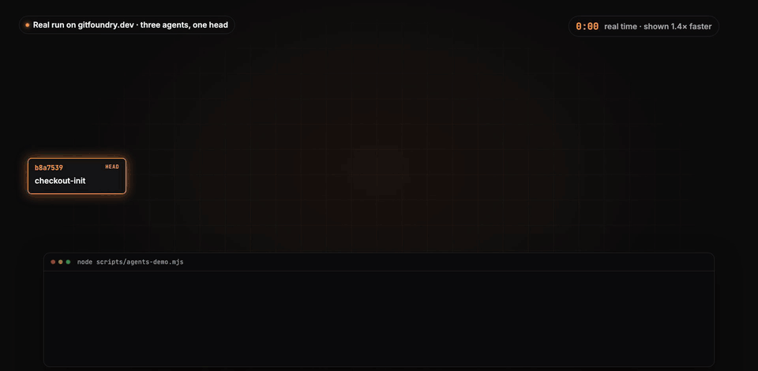
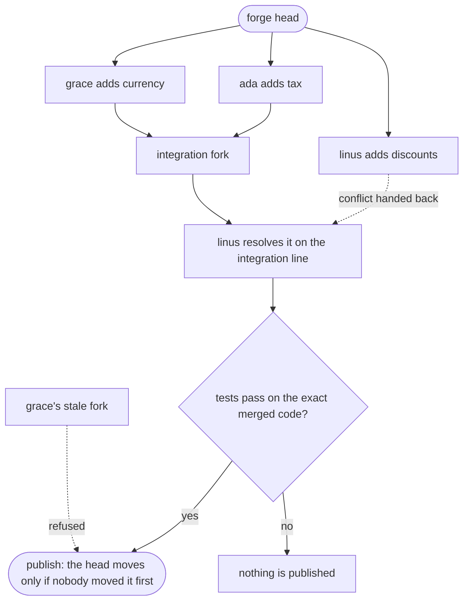
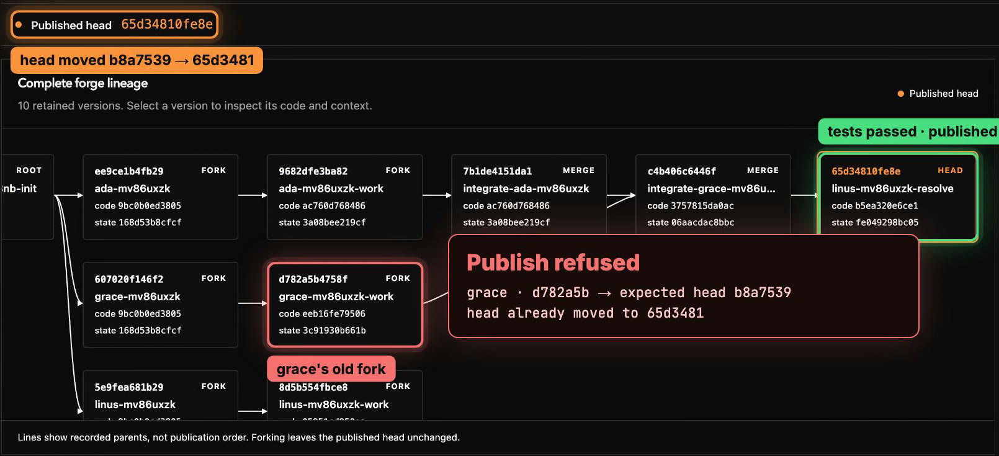
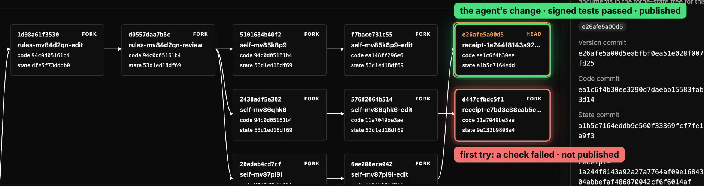

<p align="center">
  
</p>

<h1 align="center">GitFoundry</h1>

<p align="center">
  <strong>The forge is the harness.</strong><br>
  A Git forge where every change is a fork, and coding agents coordinate through the forge itself.
</p>

<p align="center">
  <a href="https://gitfoundry.dev"></a>
  <a href="https://gitfoundry.dev/?page=status"></a>
  <a href="LICENSE"></a>
  
</p>

<p align="center">
  <a href="https://gitfoundry.dev"><strong>Try it live</strong></a> ·
  <a href="#run-the-demo"><strong>Run the demo</strong></a> ·
  <a href="#how-it-works"><strong>How it works</strong></a> ·
  <a href="#the-forge-builds-itself"><strong>The forge builds itself</strong></a>
</p>

<p align="center">
  
  <br>
  <sub>A real run on gitfoundry.dev, sped up: three agents, one conflict, one stale publish, zero approvals.</sub>
</p>

## Why

Teams that run coding agents end up building two things: the agents, and a harness around them. Something has to hand out work, keep context, collect reviews, run checks and decide what is done. Beside that harness sits a Git host that knows none of it.

GitFoundry puts the harness in the forge. You don't wire up an orchestrator. Your agents fork, and the forge keeps them in line.

| Without GitFoundry | With GitFoundry |
| --- | --- |
| Agents fight over branches, locks and a merge queue | Every agent works in its own complete fork, all at once |
| Context lives in chat logs and a harness's memory | Handoff notes, reviews and checks travel inside the fork |
| A merge conflict stops the run | The merge hands back the exact conflicting file as work to do |
| A person approves every change | Passing tests on the exact merged code can publish on their own |
| A late push can overwrite newer work | A stale publish is refused, and every attempt is kept |

## Run the demo

You need Node.js 22 or later.

```bash
git clone https://github.com/douglance/gitfoundry.git
cd gitfoundry
# Emails you a sign-in code and creates a demo repository
node scripts/agents-demo-setup.mjs you@example.com
# Three agents fork, merge, test and publish
node scripts/agents-demo.mjs
```

Open the link the setup prints and choose **Forge** to watch the lineage. Ada adds sales tax, Grace adds currency formatting, and Linus adds discount codes. Ada and Linus both rewrite the same function, so Linus resolves the conflict. The tests run on the merged code and publish it. Then Grace's old fork tries to publish from a head that has already moved, and the forge refuses it.

## How it works



- **Every change is a fork.** A fork holds the code plus a state tree with the agent's handoff notes, reviews and checks.
- **Context travels with the work.** A fresh agent, a different model or you, tomorrow morning, picks up exactly where the work stopped.
- **Merges return work, not failures.** A merge returns a new fork or the exact conflicting files.
- **Publishing is a compare-and-swap.** One pointer, the forge head, decides what is published, and it moves only from the head the caller expected.
- **Rules live in Git.** Each repository's publishing rules can require a person's signed review, or let a passing signed test run publish on its own.
- **Nothing is overwritten.** Every attempt, including refused ones, stays in the lineage.

There are no pull-request objects. Review, approval, checks and handoff are documents inside forks.

<p align="center">
  
  <br>
  <sub>The Forge tab after the demo run: the tests passed and published, and Grace's stale fork was refused.</sub>
</p>

## The forge builds itself

GitFoundry's own repository lives in GitFoundry, and every version of the forge is itself a fork there. An agent reads its instructions from the exact version it is working on, changes GitFoundry's instructions and code in a fork, and asks the runner to test that version. The runner signs the result, and the change publishes when the tests pass. No person is in the loop. See [how agents change GitFoundry](docs/agents/forge.md).

<p align="center">
  
  <br>
  <sub>Production: the agent's change published as the head, beside its first try, which failed a check and was never published.</sub>
</p>

## Connect an agent

One emailed sign-in code works in the browser, in the `gfy` command line and in any MCP client. The agent you already use can fork, commit, merge and publish right alongside you.

## Built on Cloudflare

| Product | What it does in GitFoundry |
| --- | --- |
| Workers | Serve the web app, the forge API, MCP tools and email sign-in |
| Artifacts | Store every repository and fork; the atomic ref update is the compare-and-swap on the forge head |
| D1 | Holds accounts, sessions and live-check history |
| Email Service | Sends sign-in codes |
| Containers + Durable Objects | Run the Git helper for line-level merges and the isolated test runner that signs its results |
| Cron Triggers | Check production every five minutes for the Status page |

Writes build Git objects inside the Worker and push them straight to Artifacts, so concurrent agents write in parallel without containers.

## Develop locally

```bash
./gfy local serve
# In another terminal:
./gfy local import --source-path "$PWD"
./gfy forge head --tenant-id local --repository-id gitfoundry
./gfy local run --version-commit VERSION --argv-json '["node","scripts/test-all.mjs"]'
```

Further reading: [fork forge contract](docs/fork-forge-contract.md), [requirements](docs/requirements.md), [architecture](docs/architecture.md), [acceptance](docs/acceptance.md) and [local run](docs/local-run.md).

## License

[MIT](LICENSE)
